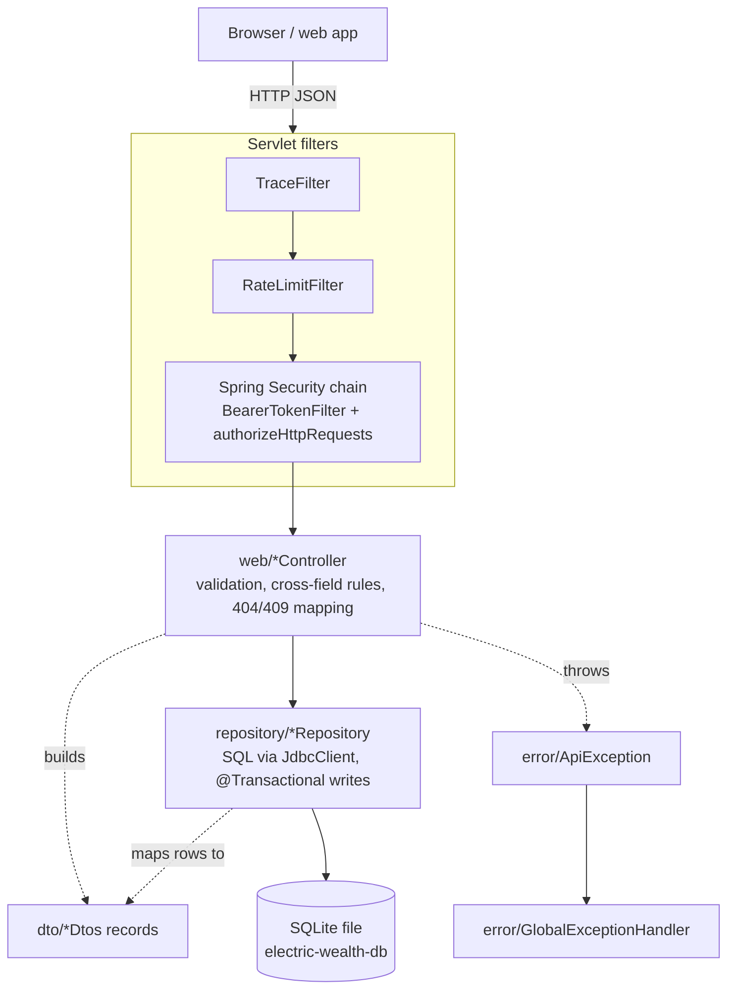

## 4. Layered Architecture

### 4.1 Layer Diagram

| Layer | Package | Responsibility |
|---|---|---|
| Filters | `web.TraceFilter`, `web.RateLimitFilter`, `security.*` | Trace id, request log, rate limit, authentication |
| Controllers | `web` | HTTP mapping, Bean Validation trigger, cross-field rules, ownership/existence checks, response assembly |
| DTOs | `dto` | Request/response records, enums, input trimming |
| Repositories | `repository` | SQL, row mapping, multi-statement transactions, ID generation, some domain defaults |
| Errors | `error` | Exception → envelope translation |
| Config | `config` | DataSource, Jackson, enum conversion, OpenAPI |

### 4.2 Dependency Rules

Observed in the imports of every class:

- Controllers depend on repositories, DTOs, `error.ApiException`, `security.AuthenticatedUser`, `config.ApiErrors`/`OpenApiConfig`.
- Repositories depend on DTOs (they return response records directly), `config.JsonEnums`, and `JdbcClient`. They never depend on controllers or throw `ApiException`.
- `DashboardRepository` depends on `AccountRepository` (only repository-to-repository dependency).
- `security` depends on `repository.SessionRepository` and `error.ErrorResponses`.
- DTOs depend only on `ApiEnums`, `Text`, Jackson/Swagger/Validation annotations.
- There is **no service layer**. Do not introduce one for a single endpoint; if added, it should sit between controllers and repositories for the whole feature.

### 4.3 What Goes Where — Decision Guide

| Logic | Put it in | Example |
|---|---|---|
| Single-field validation | DTO annotation | `@Size(min = 1, max = 40) String displayName` |
| Cross-field / time-relative validation | Controller, via `ApiException.validation(...)` | `GoalController.create`: `targetDate` must be after today (UTC) |
| "Exists and belongs to the user" checks | Controller helper `…Or404` | `AccountController.findOr404` |
| State-machine checks that need a read first | Controller | `AdvisorController.update`: only `scheduled` appointments can change (409 `NOT_SCHEDULED`) |
| Multi-statement write that must be atomic | Repository method annotated `@Transactional` | `RegistrationRepository.complete` |
| Defaults derived from the domain on insert | Repository | `AccountRepository.NewAccountRules` (tax status, contribution room) |
| Localisation of server-side labels | `web.Labels` / repository column choice | Dashboard quick links; `title_en`/`title_fr` columns |
| Converting a DB constraint violation into a business error | Controller | `AdvisorController.bookingSlot` maps `UNIQUE constraint failed` → 409 `SLOT_UNAVAILABLE` |
