## 12. Domain Models and Business Rules

### 12.1 Entity Definition Pattern

There are no entity classes. The "model" is the SQLite schema (owned by `electric-wealth-db`) plus Java records:

- **Response records** in `dto/*Dtos.java`, filled straight from rows by `Rows.of(Record.class)` when column names match (snake_case → camelCase).
- **Private row records** inside repositories when the row shape differs from the response (`ProfileRow`, `PreferencesRow`, `SecurityRow`, `MessageRow`, `PerformanceRow`, `PointRow`, `SnapshotRow`, `SlotRow`).
- **Public repository records** for internal data: `SessionRecord`, `UserRecord`, `RegistrationRow`, `OfflineClientRow`, `AccountRepository.PerformanceRecord`.

### 12.2 Value Objects

| Concept | Representation |
|---|---|
| Money | `long` minor units (cents); currency as ISO-4217 `String` (`CAD`) |
| Percentage | `double` (`dayChangePct`, `weightPct`, `progressPct`, `changePct`) |
| Dates | `LocalDate` on input; ISO `String` on output (`YYYY-MM-DD`) |
| Timestamps | ISO-8601 UTC `String` (`SqlValues`) |
| Slot time | `String` `HH:MM` (`AdvisorDtos.SLOT_TIME_PATTERN`) |
| Symbol | Upper-case `String` matching `^[A-Z0-9.]{1,12}$` (`ApiParams.symbol`) |
| Postal code | Stored as `A1A 1A1` (`AddressInput.normalizedPostalCode`) |
| Enumerations | `ApiEnums.*` (Language, Theme, MeetingType, DocumentDelivery, PerformanceRange, TransactionType, AccountType, OpenableAccountType, AlertType, NotificationType, MfaMethod, GoalCategory, Province, EducationLevel, EducationType, AppointmentStatus, HistoryRange), plus `AdvisorDtos.MessageSender`, `MarketDtos.Risk` |

### 12.3 Entity Relationships and How They're Loaded

```mermaid
erDiagram
    users ||--o{ sessions : "user_id"
    users ||--|| user_profiles : "user_id"
    users ||--|| user_preferences : "user_id"
    users }o--o| advisors : "advisor_id"
    users ||--o{ accounts : "user_id"
    accounts ||--o{ holdings : "(user_id, account_id)"
    accounts ||--o{ transactions : "(user_id, account_id)"
    accounts ||--o| account_performance : "(user_id, account_id)"
    accounts ||--o{ performance_points : "(user_id, account_id)"
    users ||--o{ goals : "user_id"
    users ||--o{ documents : "user_id"
    documents ||--o{ document_shares : "(user_id, document_id)"
    users ||--o{ notifications : "user_id"
    users ||--o| portfolio_snapshots : "user_id"
    users ||--o{ asset_allocations : "user_id"
    users ||--o{ alerts : "user_id"
    users ||--o{ quick_links : "user_id"
    users ||--o{ appointments : "user_id"
    advisors ||--o{ appointments : "advisor_id"
    users ||--o{ advisor_messages : "user_id"
    users ||--o{ education_progress : "user_id"
    education_content ||--o{ education_progress : "content_id"
    securities ||--o{ price_history : "symbol"
    users ||--o{ watchlist : "user_id"
    securities ||--o{ watchlist : "symbol"
    registrations }o--o| offline_clients : "account_number"
    registrations ||--o{ registration_security_answers : "registration_id"
    users ||--o{ user_security_answers : "user_id"
```

Relationships are inferred from the joins and `WHERE` clauses in `repository/*.java`; the authoritative schema is
in `electric-wealth-db/migrations/`. Loading is always explicit SQL — no lazy loading. Child collections are
fetched with one extra query per parent (`AccountController.detail` → `listHoldings`; `findPerformance` → points).

### 12.4 Business Rule Implementation Pattern

Rules are enforced in the controller (request-level) or repository (write-level). Catalogue:

**Accounts** ([AccountRepository.java](../../src/main/java/com/electricwealth/api/repository/AccountRepository.java), [AccountController.java](../../src/main/java/com/electricwealth/api/web/AccountController.java))
- Lists show only `hidden = 0` accounts, ordered by `sort_order`; detail/patch/transactions work on hidden accounts too.
- Only `TFSA`, `RRSP`, `FHSA`, `NON_REGISTERED` can be opened online (`OpenableAccountType`).
- New account: id `acct-xxxxxxxx`, balance 0, `CAD`, appended at `MAX(sort_order)+1`; tax status / contribution room: TFSA "Tax-free" 700 000¢; FHSA "Tax-free" 800 000¢; RRSP "Tax-deferred" null; NON_REGISTERED "Taxable" null. An empty `account_performance` row (benchmark "S&P/TSX Composite") is created.
- Patch: `nickname` updated only if the field was sent (null clears); blank nickname on open stored as NULL.
- Transactions: posted ones paged, `ORDER BY date DESC, id`; `scheduled` ones always returned in full, `ORDER BY date, id`.
- Performance: the `range` query parameter is echoed back but **does not filter** the series (the repository ignores it).

**Dashboard** ([DashboardRepository.java](../../src/main/java/com/electricwealth/api/repository/DashboardRepository.java))
- 404 if the user has no `portfolio_snapshots` row. `totalValue` = sum of visible account balances (live), the rest from the snapshot.
- Goals shown are those with `show_on_dashboard = 1`. Quick-link labels are translated to French by `Labels` when `Accept-Language` starts with `fr`.

**Goals** ([GoalController.java](../../src/main/java/com/electricwealth/api/web/GoalController.java), [GoalRepository.java](../../src/main/java/com/electricwealth/api/repository/GoalRepository.java))
- `targetDate` must be after today's **UTC** date; `currentAmount` (default 0) ≤ `targetAmount`; max $100M (`MAX_AMOUNT`); currency `CAD` only.
- `progressPct = round(current / target × 100)`; new goals are not shown on the dashboard.

**Documents** ([DocumentRepository.java](../../src/main/java/com/electricwealth/api/repository/DocumentRepository.java))
- List order `year DESC, action_required DESC, id`; optional exact filters `year`, `category` (free string).
- Detail returns a generated one-page PDF (`stubPdfBase64`) with `contentType: application/pdf`.
- Share records a row in `document_shares` expiring after 7 days (`SHARE_TTL`); no email is sent.

**Profile / preferences** ([ProfileRepository.java](../../src/main/java/com/electricwealth/api/repository/ProfileRepository.java))
- Address update replaces all fields; blank `line2` → NULL; postal code normalised to `A1A 1A1`; country must be `Canada`.
- Preferences update is partial (merge with current values, including individual notification flags).

**Notifications** — newest first (`created_at DESC, id`); `read-all` returns how many were unread.

**Advisor** ([AdvisorRepository.java](../../src/main/java/com/electricwealth/api/repository/AdvisorRepository.java), [AdvisorController.java](../../src/main/java/com/electricwealth/api/web/AdvisorController.java))
- Slots `09:00, 10:30, 12:00, 14:30, 16:00` (Toronto time) on the next 5 weekdays starting **tomorrow** in `America/Toronto`; no holiday calendar.
- A slot is open if no `scheduled` appointment of that advisor holds it; an advisor with `available = 0` has no slots.
- `meetingType` on availability is accepted and ignored (all types share slots).
- Booking or rescheduling outside the window/slot list → 409 `SLOT_UNAVAILABLE`; race lost on the unique index → same 409.
- Only `scheduled` appointments can change (409 `NOT_SCHEDULED`); cancel sets `status = 'cancelled'` (frees the slot).
- No advisor assigned → 404 `NO_ADVISOR` (availability, book, reschedule, send message).

**Education** — content titles and glossary from `_en`/`_fr` columns by language; progress upsert 0–100; glossary search `LIKE` on term or definition, sorted with a locale `Collator` (PRIMARY strength) in Java.

**Market** ([MarketRepository.java](../../src/main/java/com/electricwealth/api/repository/MarketRepository.java))
- `held` = symbol in a **visible** account of the user; `watched` = on the user's watchlist.
- `quote?symbols=` skips unknown symbols; omitted → all securities.
- Watchlist add is idempotent (`ON CONFLICT DO NOTHING`), ordered by `added_at`; remove of a symbol not on the list is a no-op.
- Roundup returns the latest `week_of` (or `""` and empty items if none).

**Registration** ([RegistrationController.java](../../src/main/java/com/electricwealth/api/web/RegistrationController.java), [RegistrationRepository.java](../../src/main/java/com/electricwealth/api/repository/RegistrationRepository.java))
- Steps: start → verify-identity → security-questions → (optional) trusted-contact → complete. A registration expires 30 minutes after start (`REGISTRATION_TTL`) and is closed once completed.
- Identity match: offline client by 10-digit account number, postal code compared ignoring spaces/case, date of birth exact.
- Security answers stored normalised (trimmed, lower-case, single spaces).
- Complete requires identity verified and answers saved; creates the user with MFA code `123456`, copies the branch record into the profile, sets preferences (email on, SMS = chosen method is SMS, push off, digital delivery, language from branch record, theme `system`, meeting `video`), a zero portfolio snapshot, a localised welcome notification, 3 quick links, and returns an already MFA-verified session.

### 12.5 Domain Events (if applicable)

Not applicable — no events are published or consumed.
